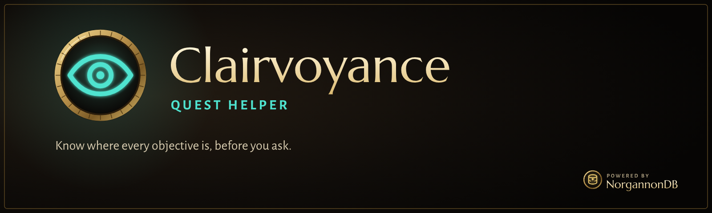

  

  
  
  

> [!WARNING]
> **Very much a work in progress.** This is an early build for WoW Forever (client 1.60.1), in
> active development and testing. Expect missing features, rough edges, bugs, and changes that
> break things between versions. Bug reports and feedback are welcome in
> [Issues](../../issues).

**Clairvoyance shows you where things are, and stays out of your way.** Your objectives on the
map, minimap and compass, a quest tracker you'll actually want on screen, and the quests you can
pick up, filtered to the ones you really can.

It never tells you which quest to do next. There's no leveling guide, and the waypoint arrow only
points where you ask.

## What it does

### On the map, minimap and compass
- **Your unfinished objectives**, each quest in its own colour. Click a marker for a new colour,
  right-click to pick one.
- **Turn-ins and quests you can take**, with the game's own **?** and **!**, filtered properly:
  prerequisites, chains, race, class, profession and reputation.
- **A compass** that points to the objectives around you, and fades out in combat.
- **Hide what you don't want**: shift-click any marker to hide its quest, and bring it back
  whenever you like.

### Track anything
- **Find any NPC, object, item or town service**: flight masters, mailboxes, innkeepers and more,
  with the game's own icons. Each tracked thing gets its own colour, a compass marker and a line in
  the tracker.
- **Gathering**: with Herbalism, Mining or Fishing, see the nodes you can gather now, and dimmed,
  the ones your next skill points will unlock.
- **Rares**: rare creatures with their level and their loot, and an optional quiet alert when one
  is near.

### The quest tracker
- **Every quest in your log**, sorted by zone, level, log order or distance, as detailed or compact
  cards.
- **Progress at a glance**: colours that warm up as you go, bright lime for finished quests, and
  progress bars if you want them.
- **Distance and direction** to each quest, and a "use item" button that works in combat.
- **Your party's progress**, compatible with Questie users in your group.

### And more
- **Tooltips** that say which of your quests an NPC, object or item is for, with your progress and
  your party's.
- **A better quest log**, with levels, optional quest IDs, and Show on map and Point arrow buttons.
- **Optional automation**: accept, turn in, pick the best-value reward, skip the chatter. It's off
  unless you turn it on, and holding Shift pauses it.
- **Settings per character or for your whole account**, with a first-run welcome that sets you up
  as Simple, Balanced or Everything.

## The NorgannonDB suite

|   | Add-on | |
|:-:|---|---|
|  | **Clairvoyance** | Quest helper: your objectives on the map, minimap and compass, and a modern tracker |
|  | **[Oracle](https://github.com/zmarotrix/Oracle)** | Dungeon and zone atlas: maps, bosses, loot, zones and professions |
|  | **[NorgannonDB](https://github.com/zmarotrix/NorgannonDB)** | The open game database underneath, with **[NorgannonDB Core](https://github.com/zmarotrix/NorgannonDB_Core)**, the shared runtime |
|  | **[NorgannonDB Collector](https://github.com/zmarotrix/NorgannonDBCollector)** | Help map Azeroth: improves the database while you play |
|  | Foresight | Planner. *Coming later* |
|  | Archivum | Look anything up in game. *Coming later* |

## Getting started

1. Download **Clairvoyance**, **[NorgannonDB](https://github.com/zmarotrix/NorgannonDB)** and
   **[NorgannonDB Core](https://github.com/zmarotrix/NorgannonDB_Core)** (on each page: **Code →
   Download ZIP**).
2. Extract them into your WoW Forever `Interface/AddOns` folder, and remove the `-main` that
   GitHub adds to each folder's name, so you end up with `Clairvoyance`, `NorgannonDB` and
   `NorgannonDB_Core`.
3. Log in. Clairvoyance welcomes you and asks how much help you'd like.

If you use Questie or pfQuest, Clairvoyance offers to turn them off for that character, so you
don't see two sets of markers.

| Command | What it does |
|---|---|
| `/clair` | the settings |
| `/clair why <questId>` | why a quest is or isn't available to you |
| `/clair welcome` | this character's first-time setup again |
| `/norg perf` | measure the suite's performance |

---

## Technical details

<b>Requirements</b>

- WoW Forever, client 1.60.1 (interface 16001)
- NorgannonDB and NorgannonDB Core

<b>Where the data comes from</b>

Quests, NPCs, objects and items come from [NorgannonDB](https://github.com/zmarotrix/NorgannonDB),
which is built from QuestieDB and pfQuest and improved by players with the
[NorgannonDB Collector](https://github.com/zmarotrix/NorgannonDBCollector). Party progress uses a
Questie-compatible message format, so you and your Questie-using friends see each other's
progress.

<b>Licence</b>

Clairvoyance is free to download and use. The source is published for transparency, but all
rights are reserved for now; see [LICENSE](LICENSE). Made by **Maro**.

